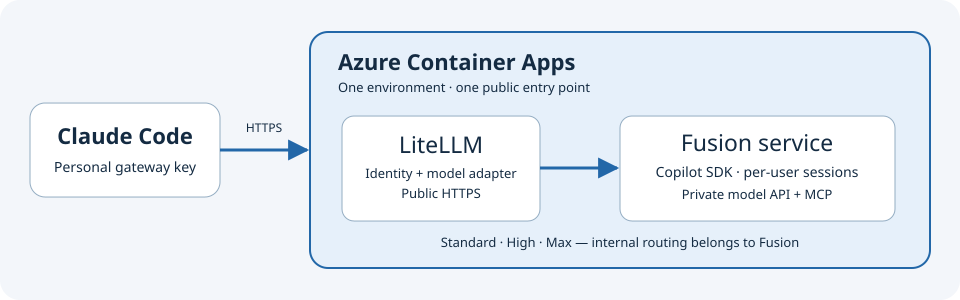

# Claude Code through Fusion on Azure

Claude Code sends every model request to LiteLLM. LiteLLM and the Fusion service run in the same Azure Container Apps environment. The Fusion service invokes GitHub Copilot Fusion through the pinned Copilot SDK. Standard, High and Max select Fusion tiers; GitHub decides the internal models and workflow.

This is the only supported architecture. The former Claude Teams, direct Copilot-provider, Primary/Secondary and automatic failover workflows have been removed. A failed request returns an error. Retries are disabled at the gateway; no alternative provider is configured.

## Start

1. Read [Azure deployment](docs/AZURE-DEPLOYMENT.md). Build the Fusion image, supply one GitHub fine-grained PAT and expiry per user through Key Vault, and deploy the two applications in one ACA environment.
2. Follow the [administrator guide](docs/ADMINISTRATOR.md) to verify the gateway and issue separate personal invitations.
3. Follow the [developer guide](docs/DEVELOPER.md): `./setup developer join --invite PATH`, then `./setup doctor`. Onboarding and doctor perform no model inference.
4. Open `START-HERE.html` for the self-contained setup guide, or run `./setup --help`.

Claude Code receives only a personal LiteLLM access key. GitHub tokens remain in the Fusion service. No Claude subscription login, shared GitHub token or provider-connection permission is used.

## How the request works

LiteLLM translates Anthropic Messages into Chat Completions using its `custom_openai` adapter. The private Fusion model endpoint translates this into an SDK session with `model="fusion"` and the requested tier. SDK text deltas stream back through LiteLLM. Validated tool calls return to Claude Code for local execution; the next request carries their results as context.

The private `/mcp` endpoint is a separate interface for explicit Fusion task tools. Connecting an MCP server does not create a Claude Code model endpoint. This release does not expose MCP through a shared gateway registration because the pinned LiteLLM MCP lifecycle does not carry the custom delegated identity consistently through initialization, discovery and invocation.

## Compatibility boundaries

This is a protocol adapter, not full Claude model compatibility. [Anthropic does not support routing Claude Code to non-Claude models](https://code.claude.com/docs/en/llm-gateway). The stable SDK cannot import an arbitrary Claude conversation losslessly: assistant and tool history is serialized as task context. Images, audio and unsupported generation/tool options are rejected explicitly. The output byte cap does not cap upstream generation tokens or charges. See [SDK interfaces and limits](docs/SDK-MIGRATION.md).

## Reference and evidence

- [Architecture and identity](docs/ARCHITECTURE.md)
- [Configuration](docs/CONFIGURATION.md) and [security](docs/SECURITY.md)
- [Troubleshooting](docs/TROUBLESHOOTING.md)
- [Validation commands and scope](docs/VALIDATION.md)
- [Implementation results](docs/IMPLEMENTATION-RESULTS.md)

The checked-in tests use synthetic credentials and network-isolated services. They do not establish live Fusion entitlement or successful cloud deployment. Source changes do not automatically update an existing deployment or this computer's Claude Code settings.
