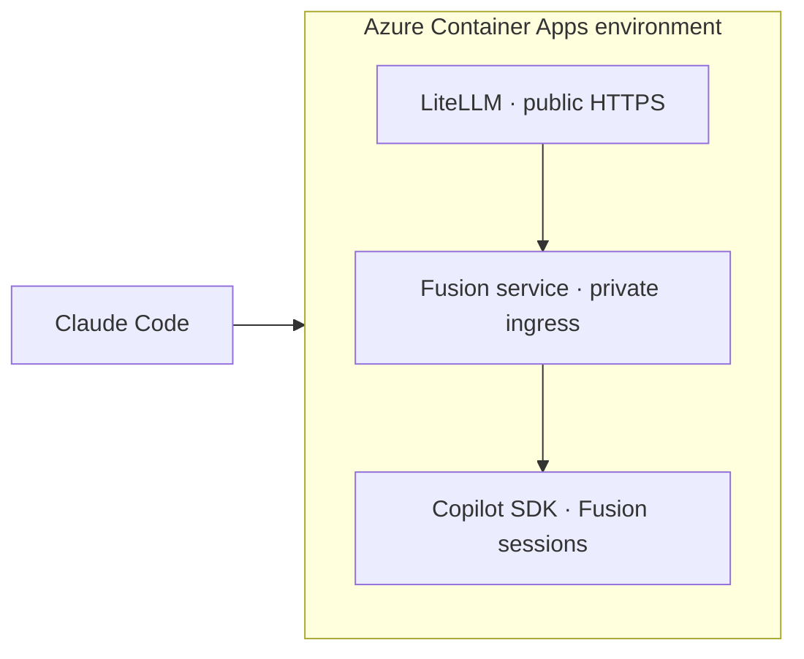

# Architecture

The main boundary has one incoming arrow. There are two applications in the same ACA environment, not an extra public Fusion destination. PostgreSQL stores gateway users and key records; Key Vault supplies credentials through managed identities. The SDK makes outbound GitHub requests. No external Claude provider is configured.

## Model protocol

Claude Code uses `/v1/messages`. The pinned LiteLLM Messages translator converts supported text and client-tool fields to Chat Completions. Static aliases `fusion-standard`, `fusion-high` and `fusion-max` all select `custom_openai/fusion-{tier}` at the private Fusion `/v1/chat/completions` endpoint. The `custom_openai` provider is deliberate: the pinned `openai` Messages path selects Responses, which this service does not implement.

The Fusion adapter creates a fresh SDK session with `model="fusion"` and `github.capi.fusion_tier`. Fusion owns all internal model selection. Neither request metadata nor a database model can select another upstream. A guard enforces the chosen deployment after authentication, rejects routing overrides, and disables retries and every router failover policy. Shared-deployment cooldowns are disabled so one user’s credential failure cannot make the route unavailable to other users.

## User identity

LiteLLM validates a personal key and supplies its authenticated user ID. The guard signs a short-lived identity assertion using a dedicated secret and sends it with an independent service bearer. Fusion validates both, resolves a server-owned subject-to-credential binding, and checks its expiry. Each user has a distinct PAT supplied by an individual Key Vault reference. The gateway identity cannot read user PATs.

Every request has a new SDK session ID and private workspace. The runtime runs in empty mode with ambient login, built-in tools, local instructions and memory disabled. Each session receives only the selected user's explicit credential. Completion, timeout and cancellation clean up the session; cleanup failure closes admission and makes the runtime unhealthy.

## Streaming and tools

Text deltas stream through a bounded channel with credential filtering across chunk boundaries. A complete tool batch is validated before it is returned, and SDK state is cleaned up before tool calls are emitted. Claude Code executes the calls locally. Tool results in its following request are serialized as context for a new SDK session.

MCP `/mcp` offers explicit `fusion_standard`, `fusion_high` and `fusion_max` task tools under the same service and delegated-user authentication. It is private and distinct from model transport. Automatic public MCP registration is intentionally absent: the pinned gateway's MCP initialization/discovery and invocation do not share one supported custom-header identity hook.

See the exact [service contract](FUSION-CONTRACT.md), [documented limitations](SDK-MIGRATION.md), and [security controls](SECURITY.md).
