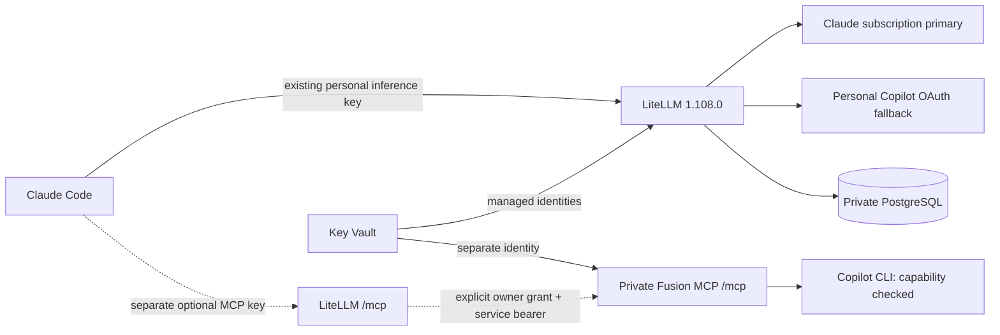

# Optional Azure and Fusion integration design

Design agreed after independent Azure, Fusion, LiteLLM and security discovery
on 19 November 2026. The initial repository baseline is 44 passing unit tests.
Existing model routing and personal Copilot OAuth remain authoritative.

Implementation verification found that the checksum-verified official Copilot
CLI 1.0.114 still lacks `--fusion-tier`, despite current GitHub documentation.
The service therefore ships with execution blocked as `unsupported_cli`.
Mocks verify the documented mapping; an audited supported CLI upgrade is a
prerequisite for live Fusion. No undocumented flags or substitute model is used.

## Compatibility and deployment modes

1. Existing gateway: all current commands, invitation formats, fallback routes
   and personal OAuth flows keep their defaults. No Terraform or Azure login.
2. Azure gateway: Terraform deploys the unchanged, digest-pinned official
   LiteLLM 1.108.0 image and persistent PostgreSQL, or uses an existing database.
3. Azure gateway with optional Fusion: the same gateway plus an internal MCP
   service. Fusion is disabled by default and supports an explicitly declared
   **single-user proof of concept only**. A shared multi-user Fusion service is
   unsupported and must remain disabled.

## Service and authentication contracts

| Boundary | Contract |
|---|---|
| Legacy inference | Existing personal virtual key, model aliases and provider OAuth; unchanged |
| Claude Code to MCP gateway | HTTPS `/mcp`; `x-litellm-api-key: Bearer <dedicated-key>` and `x-mcp-servers: <server-alias>` |
| MCP grant | New user-bound key; explicit `object_permission.mcp_servers`, MCP-only routes, `no-default-models`; never expand existing keys |
| Gateway registration | Native `/v1/mcp/server`, `transport: http`, `auth_type: bearer_token`, `allow_all_keys: false` |
| Public client access | `available_on_public_internet` controls the **client IP**, not upstream ingress; authenticated public gateway clients need it enabled |
| Gateway to Fusion | Internal ACA HTTPS `/mcp`, independent `FUSION_MCP_TOKEN`; never forward or reuse provider OAuth |
| Fusion to CLI | Explicit single-user fine-grained PAT, child-only `COPILOT_GITHUB_TOKEN`; no inherited GitHub or BYOK credentials |
| Owner | `FUSION_SINGLE_USER_SUBJECT` is the same existing LiteLLM user ID recorded on registration; only that subject may be enrolled |
| Owner assurance | Administrator-attested account mapping; a static service bearer is not end-user delegation or cryptographic GitHub identity proof |
| CLI request | Fixed executable and flags, fresh temporary HOME/workspace, prompt only, all tools denied, no repository mounts |
| Runtime failure | Missing capabilities/credentials fail closed; no substitute model or invented CLI flags |

The service does not trust caller-provided identity headers. Single-user
registration is for a dedicated single-user gateway or an independently audited
single-owner grant; it is not a way to share a token among developers. Azure
ingress isolation does not replace bearer authentication. Native authorization
must be tested against the pinned image, because current upstream documentation
and version-specific permission behavior can differ.

## Fusion interface

- Port `8080`; Streamable HTTP `/mcp`.
- `GET /health/live` checks the process; `GET /health/ready` checks configuration
  and local CLI capabilities only. Neither sends a model request.
- `fusion_standard`, `fusion_high`, `fusion_max` accept only `prompt: string`.
- The documented mapping is `--model fusion --fusion-tier standard|high|max`.
  Tool calls fail explicitly if the installed binary does not support it.
- Default `FUSION_AUTH_MODE=disabled`; the only execution mode is `single_user`.
- Required enabled settings: `FUSION_SINGLE_USER_SUBJECT`, `FUSION_GITHUB_TOKEN`,
  `FUSION_MCP_TOKEN` (at least 32 characters).
- Bounds: allowed tiers, timeout, input characters, output bytes and concurrency.
  Cancellation terminates the process group and cleans temporary state.
- Audit records contain generated request ID, configured owner, tier, duration,
  status and exit code. They exclude prompts, output and secrets. Model-specific
  usage/cost statistics are not invented.

## Infrastructure and persistence

PostgreSQL uses a private delegated subnet and linked private DNS by default.
The public gateway uses HTTPS and personal keys; Fusion has environment-only
ingress. `enable_private_networking=true` makes the entire ACA environment
private and requires customer network connectivity. This option is independent
of private database and Fusion access.

LiteLLM mounts a nonsecret JSON configuration using a native ACA Secret volume.
Its database URL, stable encryption salt and master key use Key Vault references
and managed identity. Separate identities scope Fusion secrets independently.
Terraform-created secret values are still present in state; state is sensitive.
No paid dedicated workload profile, NAT gateway, firewall or ACR is required by
default. Managed networking and persistent PostgreSQL still have costs.

## Directory ownership and dependencies

| Owner | Exclusive files | Dependency |
|---|---|---|
| Azure agent | `infra/terraform/**` | Fusion env/health contract; existing official image pin |
| Fusion agent | `services/fusion-mcp/**` | Official CLI capability verification; supported MCP SDK |
| LiteLLM agent | `_engine/azure.py`, `_engine/fusion.py`, additive `_engine/cli.py`, matching onboarding tests | Pinned API contracts and Terraform outputs |
| Security/QA agent | `tests/integration/**`, `tests/test_security_contracts.py`, package/public scanners, checks workflow | Implemented service and onboarding interfaces |
| Lead | Documentation, guide generator, `.gitignore`, cross-component decisions and final integration | All contributions and independent reviews |

Agents share this feature branch with disjoint file ownership. No concurrent
edits to the same file are allowed; overlapping fixes are serialized by the
lead. Independent security, Azure and functional reviews follow implementation.

## Verification boundaries

Required local checks: existing/new unit tests; native MCP handshake/list/call
with a mock CLI; denied unauthorized keys; Terraform formatting, validation and
mocked plans; container build; guide generation and public-content scans.
Fresh integration fixtures must not reuse the previous live pilot credentials
or database. Azure deployment and paid GitHub execution are explicitly excluded
from this implementation run. Live operator checks remain separate and opt-in.

## Primary references

- [Pinned LiteLLM MCP manager](https://github.com/BerriAI/litellm/blob/v1.108.0/litellm/proxy/_experimental/mcp_server/mcp_server_manager.py)
- [LiteLLM MCP transport and authentication](https://docs.litellm.ai/docs/mcp_config_reference)
- [GitHub CLI Fusion model selection](https://docs.github.com/en/copilot/how-tos/copilot-cli/use-copilot-cli/choose-a-model)
- [GitHub CLI authentication](https://docs.github.com/en/copilot/how-tos/copilot-cli/set-up-copilot-cli/authenticate-copilot-cli)
- [ACA secrets and managed identities](https://learn.microsoft.com/en-us/azure/container-apps/manage-secrets)
- [ACA networking](https://learn.microsoft.com/en-us/azure/container-apps/custom-virtual-networks)
- [PostgreSQL private networking](https://learn.microsoft.com/en-us/azure/postgresql/network/concepts-networking-private)
