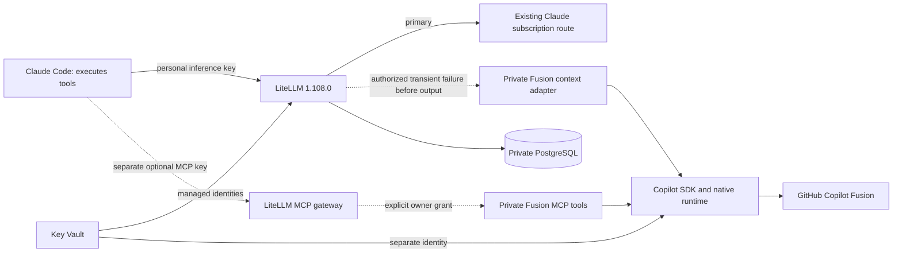

# Optional Azure and Fusion integration

The existing Claude subscription route remains primary. Existing users retain
their personal Copilot fallback and onboarding. A separate, explicitly enrolled
owner can instead select native Copilot Fusion as automatic fallback. Fusion is
disabled by default and uses Copilot entitlement, not Claude Team credits.

The adapter and MCP server share one Container App and SDK runtime. LiteLLM
runs in another Container App. The SDK manages a bundled native runtime over
stdio; no interactive CLI login or subprocess-per-prompt command construction
is required. Local startup is verified with SDK 2.0.1 and runtime 1.0.114.
Live Fusion entitlement and inference remain operator checks.

## Deployment and compatibility

1. Existing gateway: current invitations, models, personal OAuth and defaults
   remain unchanged. No Azure migration is required.
2. Azure gateway: the digest-pinned official LiteLLM image uses persistent
   PostgreSQL, Key Vault references and managed identities.
3. Optional MCP: `enable_fusion_mcp=true` adds a private, single-owner service.
4. Optional automatic fallback: `enable_fusion_fallback=true` also loads the
   LiteLLM guard and enables the private inference adapter. A separate invitation
   grants the configured owner a new restricted inference key.

The last two modes do not support shared-token multi-user execution. The owner
mapping is administrator-attested, not cryptographic GitHub identity delegation.

## Contracts and authentication

| Boundary | Contract |
|---|---|
| Existing inference | Existing personal key, aliases, provider OAuth and fallback policy |
| Opt-in inference | New owner-bound key; Claude aliases plus one guarded Fusion tier |
| Automatic eligibility | Transient primary failure before any output, once per request; no auth/input/policy fallback |
| LiteLLM to inference adapter | Internal HTTPS `/v1/chat/completions`; independent service bearer; original provider credentials removed |
| Claude Code to MCP gateway | `/mcp`, `x-litellm-api-key: Bearer <dedicated-key>`, `x-mcp-servers: <alias>` |
| MCP grant | Explicit server permission, MCP-only routes, `no-default-models`; existing keys are not widened |
| MCP registration | Native `/v1/mcp/server`, HTTP transport, bearer auth, `allow_all_keys: false` |
| LiteLLM to MCP | Internal HTTPS `/mcp`, same independent service bearer; never a GitHub/provider token |
| SDK to GitHub | Explicit single-owner fine-grained PAT; no ambient login discovery or BYOK |
| Health | `/health/live` process check; `/health/ready` local SDK protocol check, no inference |

`FUSION_SINGLE_USER_SUBJECT` must match the enrollment owner. Neither caller
headers nor the service bearer prove an end-user identity; authorization belongs
at the pinned gateway and its owner-bound guard. MCP public-client-IP policy is
independent of private upstream ingress.

## Context and tools

MCP tools `fusion_standard`, `fusion_high`, `fusion_max` accept a bounded text
prompt and return the established structured result. They cannot run tools.

Automatic fallback accepts a supported text/tool transcript, passes system
instructions separately and serializes prior conversation as context for a new
Fusion task. This is not a native continuation of the Claude session. Declared
tools have no server handlers: the SDK returns the first tool batch, the service
aborts/deletes the session, and Claude Code executes the tools. The next request
carries their actual results into another fresh task. Missing results are never
invented and historical tools are not replayed.

Responses are buffered before SSE delivery. Unsupported images/files and
generation controls fail explicitly. Output token limits conservatively bound
returned UTF-8 bytes; they do not cap upstream computation or billing. See the
complete [fallback contract](FUSION-FALLBACK.md).

## Isolation and deadlines

One warm runtime uses a minimal environment, empty agent mode, disabled built-in
tools, instructions and memory discovery. Each call has a unique session and
private workspace. Cancellation aborts/deletes state; failed cleanup closes
admission and retires the runtime rather than reusing uncertain state.

Azure defaults to one warm Fusion replica, one maximum replica, and bounded
concurrency. MCP execution defaults to 120 seconds. Automatic fallback budgets
60 seconds for primary and 140 for the adapter, including cleanup/transport;
combined settings must total at most 230 seconds under ACA's 240-second ingress
limit. Warm capacity reduces cold starts but incurs idle cost and cannot remove
network or generation latency.

## Persistence and ownership

PostgreSQL uses a private delegated subnet and linked DNS. Fusion has internal
ingress. `enable_private_networking=true` additionally makes the whole ACA
environment private and requires customer connectivity.

LiteLLM mounts configuration and, only when enabled, the guard source. Key Vault
references provide its database URL, stable salt, master key and optional service
bearer. LiteLLM receives no access to the Fusion GitHub PAT. Terraform state and
plans contain generated secrets and require restricted storage.

Implementation ownership, SDK details and primary references are recorded in
[SDK-MIGRATION.md](SDK-MIGRATION.md). Disjoint file ownership prevents concurrent
edits; independent security, Azure and functional reviews follow implementation.
Local tests use fresh databases and synthetic providers. No deployment or paid
inference is implied by those results; see [validation](VALIDATION.md).
